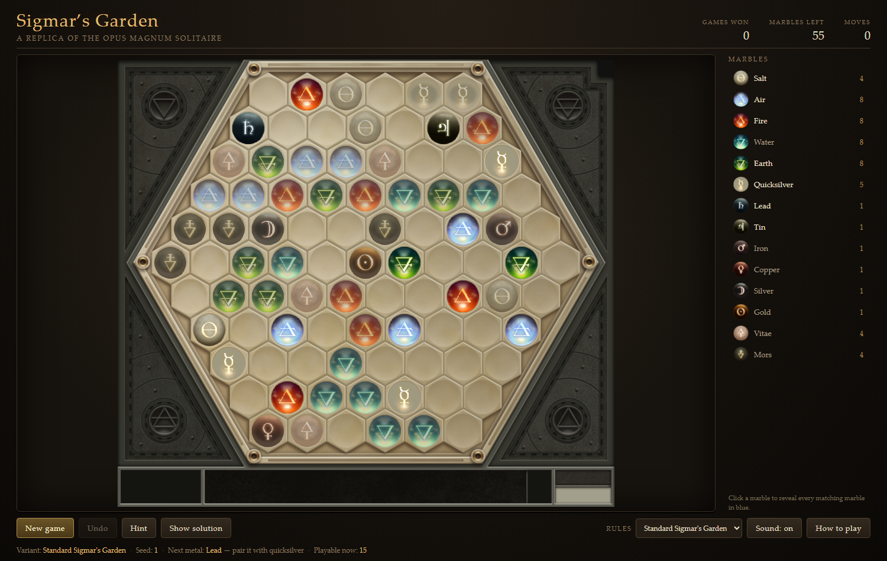
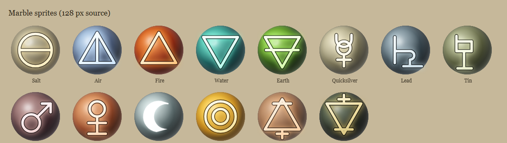

# Sigmar's Garden — a replica

A faithful, playable recreation of **Sigmar's Garden**, the hexagonal marble
solitaire hidden inside Zachtronics' *Opus Magnum*, built as a small
dependency-free web app using the original game's own art and audio.

It includes an accurate rules engine, a solvable-board generator, and a solver
fast enough to run interactively.



<p align="center">
  
</p>

> **The game's art and audio are not in this repository.** They are Opus Magnum's
> own files and are not ours to redistribute. Everything else — the engine, the
> solver, the generator, the tools, the tests — is here, and one command pulls
> the assets out of your own copy of the game. See *Quick start* below.

---

## Quick start

```bash
npm install          # esbuild + typescript, dev-only
npm run assets       # copy art/audio out of the game install (see below)
npm start            # build + serve at http://127.0.0.1:8123/
```

`npm run assets` reads from the Opus Magnum install. Override the location if
yours is elsewhere:

```bash
# PowerShell
$env:OPUS_MAGNUM_CONTENT="D:\Steam\steamapps\common\Opus Magnum\Content"; npm run assets
```

Two of the help diagrams are then *rebuilt* rather than copied (the game's
metal-rules diagram omits the quicksilver the rule is about), which needs Python
with Pillow. Without it everything still runs; only that one diagram is missing.
`npm run setup` does assets and build in one step.

Other scripts:

| script | what it does |
| --- | --- |
| `npm run build` | bundle `src/` into `public/` |
| `npm run watch` | rebuild on change |
| `npm run serve` | serve `public/` on port 8123 |
| `npm test` | headless engine test-suite (109 checks) |
| `npm run test:e2e` | drives a real browser through a full game |
| `npm run bench` | board-generation throughput |

The build output is a plain static site — any static host works, provided the
assets step has been run.

---

## The rules

The board is a hexagonal grid of carved tiles holding **55 marbles**. Marbles
are removed in pairs; **gold is the single exception and may be taken alone**
(that is what makes the odd total work out: 27 pairs + gold).

A marble only comes loose when **at least three of the six spaces around it are
empty, and those three must be contiguous**. Spaces beyond the edge of the
board count as empty, so the rim opens up first. This one rule is what makes
the game a puzzle rather than a matching exercise.

Getting the "beyond the edge" half of that right matters more than it looks. The
neighbour ring keeps all **six** slots per tile and marks the off-board ones
rather than dropping them, so a corner marble starts with three empty sides
already and an edge marble with two. An earlier version stored only the cells
that exist, which silently made every rim marble harder to free than the game
intends — 30 of the 91 tiles are affected.

There is a matching trap in the solver, which is worth recording because it cost
a great many solvable boards: it pruned any branch containing a marble with no
empty neighbour. That sounds necessary but is not — such a marble can be freed
later by clearing its neighbours, and **1504 of 2000 of the game's own deals
start with at least one marble that has no empty neighbour** (one had 28). With
that prune in place the generator rejected almost every board it dealt and fell
back to re-dealing; removing it took generation from a median of 23 attempts to
**1**, and from ~800 ms per board to ~7 ms.

Pairings:

| group | rule |
| --- | --- |
| Air, Fire, Water, Earth | match another marble of the **same** element |
| Salt | matches **any cardinal element**, or another salt |
| Metals | match **quicksilver**, but only in transmutation order: lead → tin → iron → copper → silver → gold |
| Vitae / Mors | match **each other** |

Starting counts: 8 of each cardinal element (32), 4 salt, 8 vitae/mors
(4 each), 5 quicksilver, and one of each of the six metals — 55 marbles.

**Gold may only be taken once every other marble is gone.** It is the last link
of the chain and the only marble that clears by itself, so a single click on a
lone gold finishes the board.

"Lowest metal remaining" is *not* a strong enough gate for it. Salt, vitae, mors
and the cardinals are not metals, so whenever gold is the only metal left the
lowest-metal test says "gold is next" — while those other marbles are still on the
board. Gold therefore needs the stronger "is it the last marble" test, and that
one rule now lives in the engine (`reachableMetal`, `playableKinds`) and is used
by the board's glow, the legend chip, the hint, the solver and the verifier.

This was wrong in several places at once, which is why it took three reports to
clear:

* The **board itself** drew its glow from `playableCells` — the bare "three
  contiguous free neighbours" rule — with no transmutation gate at all, so any
  loose metal lit up whether or not its tier had been reached. That was the
  highlight you kept seeing.
* The **legend chip** lit gold whenever it was merely loose.
* `canPair`'s solo branch and `verifySolution` computed the gate from
  `lowestMetalRemaining`, which passed gold through while salt remained. The
  verifier also forced `Tile.Empty` for House Colvan, which made *every* colvan
  solution unverifiable because its final gold move could never validate.

`verifySolution` additionally still carried the original off-board bug in its own
`freeIn`: it indexed `CELL_WORD[-1]` for an off-board slot, and `undefined & bit`
is 0, so off-board counted as **occupied** and legal rim moves were rejected. A
solution that replayed to an empty board was reported as invalid.

None of the game's own 300 solutions ever takes gold while a lower metal remains,
which is the behaviour this matches.

### House Colvan variant

The game documents a second ruleset: in the *House Colvan* variant, metals pair
with **another marble of the same metal** instead of with quicksilver. Select
it from the *Rules* dropdown.

The variant ships its own marble set (`Content/solitaire3.dat`): quicksilver and
vitae/mors are gone, lead drops to 2, and the other four metals come in fours.
It still totals 55 like the standard game, so it deals the same
centre-symmetric boards.

---

## What was reverse-engineered, and how

The install ships the board art, the audio, the help diagrams and all the
localised text — but **not the marble images** (they are generated by shaders
such as `GlassAtomPS` and `MetalAtomPS` over procedural geometry) and not the
rules as data. The following was recovered from the install and from the
community's reverse engineering:

* **Board geometry.** An 11×11 lattice of pointy-top hexagons with odd rows
  shifted half a cell (`odd-r` offset), **93 playable cells**, 28 clipped from
  the corners. Cell pitch measured directly from the game's `board.png`:
  **66 px horizontally, 57 px vertically**.

  The grid has two independent lattices in it and it is easy to mix them up,
  which cost a lot of time:

  * the **nodes** of `(66x + odd?-33:0 + 26, 57y + 26)` sit on the *vertices*
    where three carved tiles meet;
  * the **tile interiors** are half a pitch away from those nodes.

  Marbles belong on the tile interiors. `cellCentrePx` applies the half-pitch
  correction and the field-centring offset. The selftest asserts that every
  neighbour pair is exactly one tile width apart, because a wrong half-pitch
  parity or a neighbour table that disagrees with the coordinate function both
  show up immediately as neighbours at 33, 43, 91 or 114 px instead of 66.

  See [`tools/pitch_from_bosses.py`](tools/pitch_from_bosses.py),
  [`tools/derive_lattice.py`](tools/derive_lattice.py) and
  [`tools/derive_board3.py`](tools/derive_board3.py).

* **Board shape.** Recovered by measuring the beige card region of `board.png`
  row by row and cross-checking with groove detection. The result is a
  symmetric hexagon whose row spans are `5,7,9,9,11,11,11,9,9,7,5`.

* **Marble counts and pairings.** From the community solvers, notably
  [SigmarsBoredom](https://github.com/asandyshrew/SigmarsBoredom) (counts and
  the placement rule) and
  [WW92030's C++ implementation](https://github.com/WW92030-STORAGE/SIGMARSGARDEN)
  (the 55-marble total and the gold-alone rule). The pairing rules are also
  stated verbatim in the game's own help text (`Content/strings.csv`).

* **Colours and glyphs.** The game renders marbles with a shader over
  several textures rather than from a single bitmap, so this replica
  composites **the game's own texture layers**, reproducing the shader
  maths. See *Marble materials* below.

* **Positioning convention.** The translated help text (Chinese, Japanese,
  Korean, Russian …) refers to the elements as **风火水土** / 風火水土 / 바람·불·물·흙 /
  воздух, огонь, вода, земля in a consistent order, which fixes the mapping of
  the four triangles to air, fire, water and earth.

---

## Marble materials

Marbles in Opus Magnum are drawn by one of three pixel shaders, each
compositing a small stack of textures from `Content/textures/atoms`:

| shader | marbles | layers |
| --- | --- | --- |
| `MetalAtomPS` | the six metals | `<m>_lightramp` (a 256x1 gradient sampled by the diffuse term), `<m>_rimlight`, `<m>_symbol`, plus the four `atom.lighting` maps used to infer a normal |
| `GlassAtomPS` | air, fire, water, earth | `elements/<x>_base`, `_fog`, `_base2`, `elements/env_lights`, `elements/specular_highlight`, `<x>_symbol` |
| (plain) | salt, vitae, mors | `<x>_diffuse`, `<x>_shade`, `<x>_symbol` |

`src/render/sprites.ts` reproduces that maths:

* **Normal inference.** The metal shader derives a per-pixel normal from the
  difference in lighting from opposite directions. The four maps are named for
  the side of the sprite they *light*, so the normal points towards the bright
  side: `nx = left - right`, `ny = bottom - top`. Brightness is then
  `0.5 + 0.5 * dot(normal, lightVec)`. Getting these signs backwards inverts
  the marble — the lit side faces away from the light and the body renders
  almost black with a single small hotspot.
* **Light ramp.** The diffuse term indexes the 256-texel ramp — that is where a
  metal's colour and sheen come from.
* **Rim light.** The rim textures carry their glow along the bottom edge, so
  they are rotated a half-turn to face the light (`RotatedTexCoord`).
* **Blending.** Every shader accumulates with `dst*(1 - src.a) + src.rgb`.
  That is only consistent if the accumulation is kept *premultiplied*: with
  straight alpha the fully transparent parts of the rim-light and symbol
  textures — whose RGB is white — bleed in and wash the marbles out. Layers
  are therefore premultiplied on load and un-premultiplied when rasterised.

`tools/proto_marble.mjs` builds the same composites in Node and writes a
contact sheet to `_ref/`, which is how the blending convention and the light
direction were checked against the game's help diagrams.
`tools/sparse_capture.mjs` renders a handful of isolated marbles so
`tools/measure_sparse.py` can measure them without neighbours interfering.

---

## Architecture

```
src/
  tiles.ts        the 15 marble kinds and their metadata
  grid.ts         hex lattice geometry, neighbours, cell bitboards
  game.ts         rules: pairings, the placement rule, dead-end detection
  solver.ts       DFS solver + guaranteed-solvable board generator
  render/
    sprites.ts    marble materials, composited from the game's textures
    board.ts      board renderer, hit-testing, overlays and animations
  app/
    session.ts    a game session: moves, undo, hints, solver access
    ui.ts         canvas board, legend, toolbar, help, options
    audio.ts      original sound effects and music
  main.ts         entry point
public/           build output + copied assets (static site)
tools/            asset pipeline, build, tests, benchmarks
```

### The solver

Three things keep the search fast enough to generate boards interactively:

1. **Bitboards.** Occupancy is mirrored into four 32-bit words so testing a
   cell's surroundings is a handful of word operations.
2. **Incremental state.** Marble tallies and the lowest remaining metal are
   maintained as moves are made and undone, so dead-end pruning is O(1).
3. **Entombment pruning.** Removing a neighbour always increases a marble's
   count of empty neighbours, so `free + occupied` is a hard upper bound on how
   many empty neighbours it can *ever* have. If that bound is below three the
   marble can never come loose and the branch is dead. This rejects the vast
   majority of unsolvable boards within a node or two.

Visited states are memoised on a hash including the tallies, which collapses
the transpositions caused by removing independent pairs in either order.

Measured on this machine (400 boards, standard rules): mean **36 ms**, median
23 ms, p99 184 ms, worst case 203 ms — about 27 boards/second. The House Colvan
variant generates at roughly 90 boards/second.

### The generator

Boards are produced by shuffling the marble set over the playable cells, with
**gold always at the centre** as the game does, and handing the result to the
solver. Unsolvable arrangements are discarded and reshuffled; the solver's
entombment pruning makes rejection cheap, and the effort limit per attempt
escalates so a stubborn board cannot stall a deal. Every deal the UI presents
has been proven solvable before it is shown.

### Two layout pitfalls worth knowing

Both of these made the board look and behave wrong, and both are easy to
reintroduce:

* **A hidden overlay can still swallow clicks.** The rules panel is a
  full-screen `position: fixed` element. `display: grid` in its stylesheet
  *overrides* the `hidden` attribute, so setting `hidden` left an invisible
  grid covering the page and every click landed on it instead of the board.
  The stylesheet now has an explicit `.sg-overlay[hidden] { display: none }`.

* **The canvas backing store must match its CSS size.** The board lives in a
  flex layout that settles after the first frame. Sizing the canvas once at
  startup left the backing store 17 px taller than the element, so the browser
  squashed the whole render vertically — marbles sat progressively higher than
  their tiles the further down the board they were (about 10 px out by the
  middle). A `ResizeObserver` on the board container keeps the backing store in
  step, and the e2e suite now asserts that the backing size equals the CSS size
  and that every marble is drawn on its tile centre.

* **Lattice nodes are vertices, not tile centres.** Covered under *Board
  geometry* above. The symptom is that every marble looks pushed towards one
  corner of its hexagon — because it is sitting on a corner, not in the middle.

---

## Controls

* **Click** a marble to select it, then click its partner. Every legal partner
  is outlined. Clicking gold twice takes it alone.
* **Legend** (right) — click any marble kind to highlight every one on the board.
* **Hint** — suggests a move that keeps the deal winnable.
* **Show solution** — solves the current position and plays it out.
* **Undo**, **New game**, **Rules** (variant), **Sound**, **How to play**.
* **Keyboard**: `N` new game, `U` undo, `H` hint, `Esc` deselect.

URL parameters, handy for testing and sharing a specific deal:

| parameter | effect |
| --- | --- |
| `?seed=1234` | deal a specific, reproducible board |
| `?motion=off` | disable animations (also honours `prefers-reduced-motion`) |
| `?help` | open the rules panel |
| `?solution` | deal, then solve automatically |
| `?calibrate` | open the marble-alignment panel (see below) |

---

## Board geometry, and the off-board bug

The lattice is `x = 66c + 33·even + 57`, `y = 57r + 69`, derived from the beige
card's own bounds in `board.png`. Sampling the card row by row gives a
hexagonal shape centred on **x = 420, y = 354**, widest at the middle
(x 21..819) and narrowest at the top (x 174..666).

Two mistakes here are worth recording because both are visible on screen and
neither is obvious from the code:

* **The stagger direction.** Putting the half-pitch on the odd rows instead of
  the even ones shifts every second row 33 px sideways, so that row's end tiles
  sit over the walnut frame. Testing all combinations of stagger direction and x
  constant against the card's measured width at each row leaves exactly one that
  puts **no** tile outside the card — the one in the source. Configurations that
  looked plausible pushed tiles at columns 9–10 over the frame on rows 2, 4 and
  6.
* **No vertical half-pitch.** Adding one spaces rows 85/28 px apart alternately,
  which leaves only two of a cell's six neighbours at the tile width instead of
  all six. The selftest asserts every neighbour pair is exactly 66 px apart,
  which catches this immediately.

Because the playable area is the *intersection* of the lattice and the card,
and the card narrows towards the top and bottom, the row widths are

```
6, 7, 8, 9, 10, 11, 10, 9, 8, 7, 6      total 91 cells
```

Note this is **not** a simple `[lead, 10-lead]` column span. The even rows
carry the half-tile stagger, so a row holding an even number of tiles sits half
a tile off the column axis — row 0 spans columns 2..7 while row 1 spans 2..8.
Getting this wrong in either direction (too many tiles in the narrow rows, or
the spans mirrored) is what puts pieces outside the carved area.

---

## Sound

All audio is the game's own, transcoded from `Content/sounds` and
`Content/music` by `tools/copy-assets.mjs`:

| file | used for |
| --- | --- |
| `solitaire_select.ogg` | picking up a marble |
| `solitaire_match.ogg` | a successful pair |
| `solitaire_start.ogg` | a new deal |
| `solitaire_end.ogg` | board cleared / dead end |
| `click_button.ogg` | toolbar buttons |
| `ui_modal.ogg` | help and statistics overlays |
| `solitaire.ogg` | background music (looped) |

### Two switches, and how they interact

The toolbar has **Sound** and **Music**, which are independent:

* *Sound off* silences everything, music included, and persists as `sg.muted`.
* *Music off* stops only the bed; effects keep playing. Persists as `sg.music`.

The music button reads `Music: off` whenever the music is inaudible, so it
reflects what you actually hear rather than just its own stored flag.

Two bugs lived in this area, both reported from play:

* `unlock()` ran on every click and started the music regardless of the sound
  setting, so turning sound off still restarted the music on the next click. It
  now consults both switches and only starts a paused track.
* The pick-up sound hung off the session's `reject` event, so a normal tap was
  silent and only mis-clicks made a noise. It is now driven by a `select` event.

### Levels

Per-effect gains live in `GAIN` in [`src/app/audio.ts`](src/app/audio.ts) and the
music sits at `MUSIC_GAIN` (0.22) against a 0.85 master. The effects were
previously around a quarter of full scale while a near-full-scale music bed
played underneath, which made them effectively inaudible — worth knowing if you
re-balance them.

Browsers refuse to start audio until the user interacts with the page, so
playback unlocks on the first click. **Double-click the Sound button** to print
a diagnostics line (mute state, context state, whether the track is paused, and
the last playback refusal) to the console and the status bar.

```bash
npm run test:audio    # files served, decode, fire during real play, gating matrix
```

---

## The game's own boards, decoded

The game ships its real layouts, and they decode completely:

```
Content/solitaire.dat    50,000 boards
Content/solitaire2.dat    5,000
Content/solitaire3.dat    5,000
```

**Container.** int32LE record count, then fixed **165-byte** records
(`50000 * 165 + 4 = 8,250,004`, exact).

**Record.** `165 = 3 + 54 × 3`. Three header bytes, always `07 05 00`, then 54
triples of `(type, q, r)`, where `(q, r)` are **hex axial coordinates centred on
`(5, 0)`**. Those 54 positions are exactly the radius-5 hexagon **minus its
centre**:

```
shell 1:  6     shell 4: 24
shell 2: 12     shell 5: 30
shell 3: 18     -----------
                     90 cells
```

The missing 91st cell is the centre, and it is always gold: **`type 7` never
occurs anywhere in the file**, so gold is stored implicitly. That is why the
game always draws it in the middle.

**Type multiset** — one distinct multiset across all 50,000 records:

```
type  1 ×4   type  6 ×5   type 11 ×1
type  2 ×8   type  8 ×1   type 12 ×1
type  3 ×8   type  9 ×1   type 13 ×4
type  4 ×8   type 10 ×1   type 14 ×4
type  5 ×8                 (type 7 = gold, implicit)
```

54 + gold = **55**, the exact Sigmar's Garden multiset. By count: `×4` =
Salt/Vitae/Mors, `×5` = quicksilver, `×8` = the four cardinals, `×1` = the five
metals plus gold.

**Symmetry — a correction.**

An earlier version of this file claimed the real boards are centre-symmetric, on
the strength of a "59.5% of boards are 180-invariant" measurement. **That
measurement was meaningless and the claim was wrong.** The mistake: it tested
whether the set of *occupied positions* maps to itself. Because the positions come
from a radius-5 hexagon and every one of its 91 cells is playable, that is true of
**every** board by construction — it measured a property of the region, not of
any deal.

Tested properly, on the marble *types*:

```
map (q, r) -> (10 - q, -r)     position set invariant 90/90
                               TYPE pattern invariant  0/3000
```

So the game does **not** deal symmetric boards. The region is symmetric; the deals
are not.

A position set invariant sounds like it means something, but it does not: there
are 55 marbles and 91 playable cells, so the occupied set is *always* the whole
region, which is symmetric by construction. It is the arrangement of kinds that
could be symmetric, and none of the 50,000 boards is.

That also disposes of the tempting generator design. On the board, the mirror
`(x, y) -> (x, 10 - y)` *is* the one neighbour-preserving symmetry (91/91 cells),
and dealing mirrored pairs is mechanically easy — but every such construction was
unsolvable:

| construction | solved |
| --- | --- |
| mirrored marble types | 0/40 |
| pairs split across mirrored cells | 0/25 |
| 180-degree rotation (not even a neighbour automorphism: 0/91) | 0/20 |
| odd kinds on the fixed middle row, rest as mirrored pairs | 0/30 |
| random deal, for comparison | 20/20 |

The fourth is the one that *should* work: 55 marbles over 11 fixed cells and 40
mirror pairs means 11 kinds on the middle row and 22 pairs, which balances
exactly — 6 odd-count kinds, gold on the centre, 44 remaining marbles in 22
pairs — and it produces boards that are perfectly symmetric and carry the exact
marble multiset. They are still never solvable.

After the off-board fix and the removal of the bad solver prune, the symmetry
argument for solvability finally holds up: both halves do become loose together,
so mirrored play *is* legal. It just always dead-ends anyway.


The reason is structural: if a marble has three contiguous empty neighbours then
so does its mirror, so both copies become loose **together** and are locked
**together**, and the board dead-ends. Symmetry makes a board harder to clear, not
easier, under this rule.

### What this means for the generator

The decode settles the algorithm, and it is **not** a symmetric arrangement of
marbles — it is a symmetric arrangement of *cells*:

* The playable board is a radius-5 hexagon, so it has a **120-degree rotational
  symmetry** about the centre cell. In board coordinates that rotation has to be
  taken on the tile centres rather than on the index grid, because the rows are
  staggered by half a pitch; done that way it maps neighbours to neighbours on
  all 91 cells.
* Its orbits are 31, of which 30 are triples. The centre `(5,0)` is the fixed
  point and **gold always sits on it** (2000 of 2000 boards).
* A deal occupies **the centre plus 18 orbits of three** — `1 + 18 x 3 = 55`
  cells, the marble count exactly. There are only `C(30,18) = 86,493,225` whole
  supports.
* **97.4% of orbits are wholly occupied or wholly empty** (9280 filled, 5818
  empty, 402 partial across 500 boards). So the support is *almost* whole orbits,
  and the residue of partial orbits matters — see the difficulty notes below.
  96.4% of boards (482/500) are fully symmetric.
* The 27 marble *pairs* are then dealt across that support, and are **not**
  symmetric in kind — across 3000 of the game's own boards the kind pattern is
  never 3-fold symmetric.

The rotation is worth stating exactly, because the obvious axial formula is
wrong. About `(5,0)` in the file's coordinates the automorphism of the region is

```
(q, r) -> (-(q-5) - r + 5,  (q-5))
```

which satisfies `R^3 = id` and maps the region onto itself. The textbook
`(q, r) -> (-r, q+r)` does not — it has the wrong sign on `r` — and using it made
the support look only 56% symmetric. With the correct form every orbit is a
clean triple.

#### Two difficulties

Both modes deal the whole 55 marbles onto the centre plus 18 orbits of the
120-degree rotation, so both are 3-fold symmetric. They differ in how tightly
the opening position is closed:

| | loose at start | mean | range | solvable |
| --- | --- | --- | --- | --- |
| the original's boards | — | **7.42** | 6..9 | — |
| **Hard** | median 9 | **8.20** | **6..9** | 99% |
| **Easy** | median 21 | 22.25 | 15..33 | 99% |

"Loose" is how many marbles are playable at the first move, and it is decided
*entirely* by which cells hold marbles — the placement rule is about empty
neighbours, so swapping marble kinds on a fixed support never changes it. That
makes it cheap to screen supports before dealing anything.

##### How Hard gets there

The original's opening position is very closed, and its distribution is
**bimodal** — measured over 10,000 of its own boards:

```
loose 6: 37.77%    loose 7: 20.34%    loose 8: 3.79%    loose 9: 38.10%
```

Hard reproduces the range by growing connected supports and screening them
against that distribution, sampling about 40 microseconds per support and
keeping the closest match. It reaches 6..9 on every seed; values 7 and 8 do
occur in the original but are rare, and the search lands on 6 or 9 far more
often. Easy declines the shaping entirely, which is what leaves it wide open.

Neither mode is symmetric in the marble *kinds* — the original's never are, and
a kind-symmetric deal is unsolvable, because both copies of a marble become
loose together and then lock together.

##### What still differs

Hard's mean is 8.20 against the original's 7.42, and it does not hit 7 or 8
often. Two things were established about why, and they are worth recording
because they rule out the obvious fixes:

* **Symmetric supports can only produce loose counts that are multiples of
  three.** A support of whole orbits is 3-fold symmetric, and the three images of
  any cell are loose or locked together, so the count comes in threes. Sampling
  thousands of grown supports yields only 6, 9, 12, 15, ... — never 7 or 8.
* **The original's boards are not perfectly symmetric.** 96.4% of them are
  (482/500), and 97.4% of their orbits are all-or-nothing, but a small residue of
  partial orbits (0.80 per board) is exactly what lets their counts sit off the
  multiples of three.

So the missing 7s and 8s come from partial orbits. Introducing them by hand
(hill-climbing single-cell swaps toward a target count) does reach 8 on about
half of attempts, but it wrecks solvability and drops the loose count as low as
6 on others, so it is not used. Reproducing the original exactly would need its
per-cell choice rule, which the file's own distribution of partial orbits does
not yet disclose.

##### The run structure, measured exactly

Pooling every marble of every board in the file gives 2,128,418 **interior**
observations, and they are strikingly regular. Only **3.148%** of interior
marbles are loose, and the frequency of a marble's emptiness depends only on the
*run structure* of its six-slot ring, not on where the runs sit:

| ring contents | runs | share of all interior marbles |
| --- | --- | --- |
| full (no empties) | — | 14.79% |
| one run of 2 | `(2)` | 3.98% each |
| one run of 1 | `(1)` | 3.66% each |
| two runs of 1, opposite | `(1,1)` | 2.04% each |
| run of 2 plus a run of 1 | `(2,1)` | 1.75% each |
| two runs of 2 | `(2,2)` | 1.26% each |
| two runs of 1, adjacent | `(1,1)` | 1.23% each |
| three runs of 1 | `(1,1,1)` | 0.55% each |

The within-group spread is about 1%, so the generator's behaviour is captured by
the run multiset alone. A fit of `p ∝ (1/2)^n1 · b^n2` over the 32 non-loose
masks gives `b = 0.785` but is rejected (chi-square ≈ 4.6e5 on 30 df), so this
is a description of the output rather than a model of the process. It is the
most useful lead for finishing the job: a candidate generator can be scored
against this table directly.

##### The measure of "closed"

The original puts roughly the *same* amount of empty space around its marbles as
a random placement does; it just breaks it into shorter runs. Measured over 2000
of its boards:

| | marbles with >=3 empty neighbours | with 3 **contiguous** |
| --- | --- | --- |
| the original | median 19, mean 21.9 | **median 7**, mean 7.4 |
| a scattered support | median 21 | median 21 |

Since the rule needs three *contiguous* empties, run length is what gates play.
Notably the original almost never lets a marble with exactly three empty
neighbours have them adjacent — and a marble's six-neighbour ring is where that
shows up, not in the shape of the empty region as a whole.

### The three shipped variants

Decoding the other two files settles what the variants actually contain — and
corrected a table that had been written from memory:

| file | records | marble set |
| --- | --- | --- |
| `solitaire.dat` | 50,000 | standard: salt 4, cardinals 8 each, quicksilver 5, metals 1 each, vitae 4, mors 4, gold 1 = **55** |
| `solitaire2.dat` | 5,000 | standard **plus Quintessence** (file type 16): salt 4, cardinals 8, quicksilver 5, metals 1, vitae 3, mors 3, quintessence 2, gold 1 = **55** |
| `solitaire3.dat` | 5,000 | **House Colvan**: salt 4, cardinals 8 each, lead 2, tin/iron/copper/silver 4 each, gold 1 = **55** |

House Colvan is the metals-pair-with-themselves ruleset: quicksilver, vitae and
mors all disappear, lead drops to 2, and every metal comes in an even count
because none of them needs a quicksilver partner. It still totals **55**, the
same as the standard game, which matters more than it looks:

* A symmetric support is the centre plus whole 120-degree orbits, so its size is
  always `1 + 3k`. At 55 both variants qualify — `1 + 3 x 18`.
* An earlier version of `COLVAN_COUNTS` read the metal type ids one place too low
  (id 8 is **lead**, not tin), giving lead 0 and tin 2 and a total of **51**.
  Since 51 is not `1 + 3k`, no arrangement of whole orbits could total it, and
  the Colvan board came out visibly asymmetric. `variantTotal('colvan')` is now
  55 and both variants deal centre-symmetric boards; `test:variants` asserts it.

The selftest now asserts the file-verified numbers, and the variant generates
25/25.

**Quintessence is not implemented.** The game ships `atoms/whiteout.png` for it
but no symbol sprite, so it cannot be rendered faithfully yet.

---

## Aligning the marbles

The marbles are composited from the game's texture layers, and the lattice that
produces does not seat perfectly on the carved tiles: the residual is not a
clean multiple of the pitch, so it was settled by eye against the artwork rather
than fitted from pixel statistics.

That residual is now baked into `cellCentrePx` as `NUDGE_X = 32.5`,
`NUDGE_Y = -9.5` (board pixels), so the game is aligned out of the box. Two ways
to redo or supersede it:

```js
sgCalibrate()            // show / hide the panel
sg.setCalibration(x, y)  // nudge on top of the baked value, in board pixels
sg.getCalibration()
```

The panel (`?calibrate`) moves **every marble relative to the board** on both
axes, with sliders (0.1 px steps), ±1 / ±0.1 buttons, numeric entry, and
`Alt`+arrow-key nudging (`Alt`+`Shift` for 10 px). *Copy values* puts the current
pair on the clipboard and in the console. The offset applies to drawing *and*
hit-testing, so clicking always lands on the marble you can see.

To bake in a new value, add it to `NUDGE_X` / `NUDGE_Y` in
[`src/grid.ts`](src/grid.ts).

---

## Testing

```
npm test                  # 106 engine checks: geometry, rules, solver, generator
npm run test:offboard     # off-board sides count as empty
npm run test:rotation     # 120-degree symmetry of the support
npm run test:difficulty   # hard is tight and in the original's range, easy is open
npm run test:geometry     # neighbour ring vs tile geometry, region shape
npm run test:symmetry     # which transforms preserve the lattice
npm run test:metals       # metal highlight obeys the transmutation order
npm run test:metal-legend # the legend agrees with the board, in a real browser
npm run test:legend       # the legend's lit state, driven in the browser
npm run test:hint-solution # Hint marks a real move and Show solution plays moves
npm run test:e2e          # real browser: deals, plays a full game, undo, hints, variants
npm run test:audio        # files served, decode, fire during play, gating
npm run test:calibrate    # marble alignment panel
```

`npm test` bundles the TypeScript with esbuild and runs it headlessly, so the
tests exercise exactly the code the browser runs. The e2e test drives Edge or
Chrome over the DevTools protocol and asserts, among other things, that a
complete 28-move game can be played through the real click path and that no
uncaught errors occur.

---

### Help artwork

The help panel's diagrams are the game's own, except where it does not ship the
art they need.

* `purification.png` is **regenerated** by `tools/build_purification.py`. The
  shipped diagram shows each of the five transmutable metals twice — once in a
  top row, once in a bottom row, with `+` glyphs between the rows and `>` glyphs
  after them, ending at gold. It never shows the **quicksilver** every one of
  those metals is actually paired with, which is the rule it is meant to teach.
  It is rebuilt as five formulas side by side, each read downwards and across:

  ```
  lead   + QS  >  tin
  tin    + QS  >  iron
  iron   + QS  >  copper
  copper + QS  >  silver
  silver + QS  >  gold
  ```

  The block comes out roughly square, which is what lets it sit in one row beside
  the short Vitae/Mors diagram instead of needing a tall column of its own.

  The metal orbs, the gold orb and the `+` / `>` glyphs are lifted straight out of
  the shipped image, so the artwork is the game's own.

* `quicksilver_orb.png` is lifted from the game's help art by
  `tools/extract_quicksilver_orb.py`. There is no quicksilver *body* to take from
  the atoms folder — the game ships it as a **glyph** plus a diffuse tint
  (`quicksilver_symbol.png`) and draws the sphere with a shader. Its help artwork
  does contain quicksilver orbs, though: `matching_rules/projection.png` pairs
  each metal with one, drawn by the game in exactly the style of the other help
  diagrams, so that is what the diagram uses.

  An earlier attempt composited a sphere in Python from the light direction and
  the diffuse tint. It was the right size but the wrong look — flatter and
  greyer than the game's, so it stood out beside the metal orbs. The app's own
  board sprite is no better here: it flat-tints the sphere, which reads as a pale
  coin at help-diagram scale. Using the game's own help art is both simpler and
  correct.

  The extracted orb is written out at the metal orbs' own 56x65 rather than
  scaled down and back up, so the grid stays legible without resampling.

Both scripts read the original out of the Opus Magnum install, so nothing has to
be kept in the repo to regenerate them.

All four diagrams live in the same two-column `.sg-help-pair` grid — cardinals
and salt on the first row, metals and vitae/mors on the second — so every figure
is the same size and they line up.

## Assets and licensing

**All art and audio belongs to Zachtronics and is taken from a local
installation of *Opus Magnum*.** This repository contains no game assets;
run `npm run assets` to copy them out of your own install. If you do not own
the game, the app will not have textures or sound.

The source code in this repository is an independent reimplementation of the
game's rules and is provided for study.

Everything the app loads at runtime lives in `public/assets/`:

```
assets/textures/  board.png, hover/spawn/pulse sprites, dividers  (from Content/textures/solitaire)
assets/help/      the in-game rule diagrams                      (from Content/textures/solitaire/help)
assets/atoms/     per-marble material layers                     (from Content/textures/atoms)
assets/atoms/elements/  cardinal element layers                  (from Content/textures/atoms/elements)
assets/audio/     solitaire_select/match/start/end, music        (from Content/sounds + Content/music)
```

`tools/copy-assets.mjs` transcodes the `.wav` effects to Ogg Vorbis with
`ffmpeg` when it is available and falls back to copying them otherwise.

### Reference material in `_ref/`

`tools/derive_board3.py`, `tools/derive_board2.py` and `tools/extract_ref.py`
write diagnostic images into `_ref/` showing how the board shape and palettes
were measured (lattice overlays, lobe detection, palette samples). These are
scratch artefacts and can be deleted.
